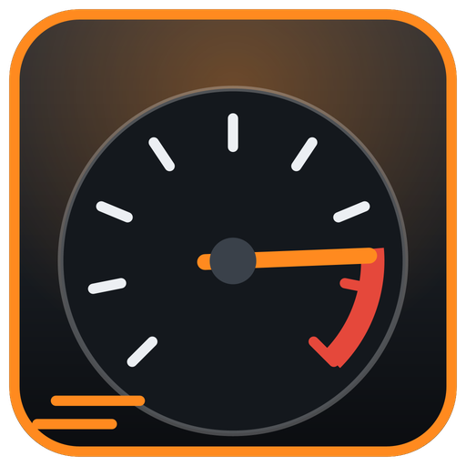
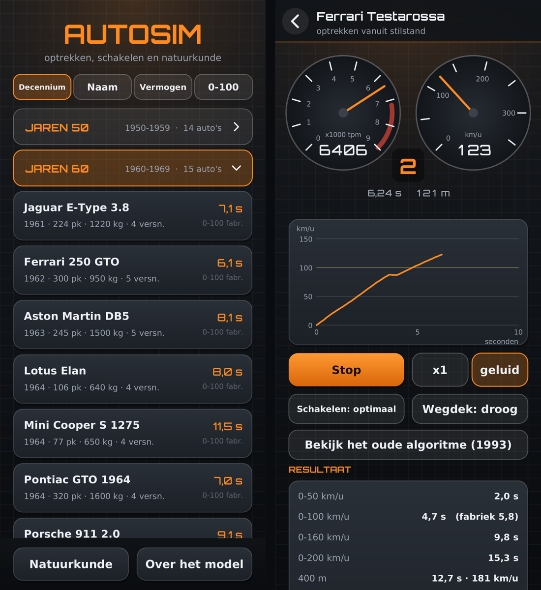

<p align="center"></p>

<h1 align="center">Autosim</h1>

<p align="center">
Optrekken, schakelen en natuurkunde: een Android-app die simuleert hoe snel een auto optrekt,<br>
op basis van versnellingsbak, motorkoppel, gewicht, banden en luchtweerstand.
</p>

<p align="center">


</p>



Autosim is een nieuwe versie van een Pascal-programma uit 1993. De autodatabase van toen is gebleven, maar het optrekken wordt nu echt natuurkundig berekend. Daarnaast zijn er 106 iconische auto's bijgekomen, van de jaren 50 tot nu.

## Inhoud

- [Installeren](#installeren)
- [Wat zit erin](#wat-zit-erin)
- [De auto's](#de-autos)
- [Het rekenmodel](#het-rekenmodel)
- [Hoe nauwkeurig is het?](#hoe-nauwkeurig-is-het)
- [Het oude algoritme uit 1993](#het-oude-algoritme-uit-1993)
- [Gegevensbronnen](#gegevensbronnen)
- [Merklogo's (optioneel)](#merklogos-optioneel)
- [Bouwen](#bouwen)
- [Testen op de desktop](#testen-op-de-desktop)
- [Projectindeling](#projectindeling)
- [Bijdragen](#bijdragen)
- [Versies](#versies)
- [Licenties](#licenties)

## Installeren

1. Download `Autosim.apk` bij de [Releases](../../releases) van deze repository, of bouw hem zelf (zie [Bouwen](#bouwen)).
2. Open het bestand op je telefoon en sta installeren uit deze bron toe.

De app werkt vanaf Android 5.0, in staande stand, en heeft geen internet of andere rechten nodig.

De merklogo's zitten niet in deze repository. Bouw je de app zelf, haal ze dan eerst op; zie [Merklogo's](#merklogos-optioneel). Zonder logo's werkt alles gewoon, alleen zonder logo in de kop en met een leeg scherm Merken.

## Wat zit erin

- **Garage:** 134 auto's in inklapbare groepen per decennium. Je kunt ook sorteren op naam, vermogen of berekende 0-100 km/u.
- **Autogegevens:**
  - vermogen, koppel, gewicht, banden en luchtweerstand;
  - de overbrengingen met de maximale snelheid per versnelling en het schakelpunt;
  - het schakelschema (snelheid tegen toerental per versnelling);
  - de koppel- en vermogenskromme.
- **Optrekken:**
  - een live simulatie vanuit stilstand tot de topsnelheid, met toerenteller, snelheidsmeter, versnelling en een grafiek van snelheid tegen tijd;
  - een gesynthetiseerd motorgeluid dat met het toerental en het aantal cilinders meegaat;
  - de uitkomsten 0-50, 0-100, 0-160 en 0-200 km/u, 400 m, 1000 m en topsnelheid, naast de fabrieksopgave;
  - instelbaar: optimaal schakelen of pas bij het maximale toerental, droog of nat wegdek, en 1x, 2x of 4x zo snel afspelen.
- **Het oude algoritme uit 1993**, om het verschil te zien.
- **Vergelijken:** twee auto's onder dezelfde omstandigheden, met een gezamenlijke grafiek.
- **Natuurkunde:** de rekenhulpen uit het oorspronkelijke programma.
  - Rijweerstand: lucht, rol en helling.
  - Remweg, met een wrijvingstabel per wegdek.
  - Maximale bochtsnelheid.
- **Merklogo's (optioneel):**
  - het logo van het merk, groot in de kop van het autoscherm en het optrekscherm;
  - het scherm **Merken**, met de logo's van 387 automerken in één stijl, oranje op zwart. Je bladert erdoor in een raster of één voor één, met knoppen of door te vegen.

## De auto's

| Decennium | Aantal | Een greep |
|---|---:|---|
| Jaren 50 | 14 | Mercedes-Benz 300 SL, Jaguar XK120, VW Kever, Fiat 500, Citroën DS 19, Corvette 1957 |
| Jaren 60 | 15 | Jaguar E-Type, Ford Mustang, Lamborghini Miura, Ferrari 250 GTO, Aston Martin DB5, Shelby Cobra 427, Ford GT40 |
| Jaren 70 | 15 | Lamborghini Countach, Porsche 911 Turbo, VW Golf GTI, Lancia Stratos, Datsun 240Z, BMW M1 |
| Jaren 80 | 29 | Ferrari F40 en Testarossa, Porsche 959, Audi Quattro, BMW M3 E30, Lancia Delta Integrale, Citroën 2CV |
| Jaren 90 | 20 | McLaren F1, Honda NSX, Toyota Supra, Nissan Skyline GT-R, Mazda MX-5 en RX-7, Lamborghini Diablo |
| Jaren 00 | 14 | Bugatti Veyron, Porsche Carrera GT, Ferrari Enzo, Ford GT, Nissan GT-R, BMW M3 E46 |
| Jaren 10 | 15 | Lexus LFA, Ferrari 488 GTB, Lamborghini Aventador, Porsche 911 GT3 RS, Honda Civic Type R, Bugatti Chiron |
| Jaren 20 | 12 | Porsche 911 GT3 (992), Corvette C8, Toyota GR Yaris, Ferrari 812 Competizione, McLaren 765LT |

De meeste auto's uit de jaren 80 en 90 komen uit de oorspronkelijke database van 1993. Alle auto's hebben een verbrandingsmotor; elektrische auto's passen niet in een model met een versnellingsbak en een koppelkromme.

## Het rekenmodel

De simulatie rekent in stappen van 2 milliseconden:

```
trekkracht   = koppel(tpm) × overbrenging × differentieel × rendement / wielstraal
               begrensd door de grip van de aangedreven wielen (met gewichtsverplaatsing)
weerstand    = rolweerstand × m·g + ½ · ρ · cw · A · v²  (+ helling, wind)
versnelling  = (trekkracht − weerstand) / (m × toeslag voor draaiende delen)
```

Daarbij:

- **Wegrijden:** het wegrijtoerental wordt per auto geoptimaliseerd, zoals een testrijder dat doet. De koppeling slipt daarna 1 seconde: het toerental zakt naar dat van de aandrijfas en loopt vanaf dan gelijk op met de snelheid. Een DCT (dubbele koppeling of geautomatiseerde bak) koppelt in 0,55 seconde in.
- **Automaten:** die hebben een koppelomvormer. Bij stilstand draait de motor op het stall-toerental. Daarna loopt het toerental geleidelijk op naar dat van de aandrijfas, terwijl de koppelvermenigvuldiging afneemt van 2,0 naar 1,0.
- **Schakelen:** de app schakelt zodra de volgende versnelling meer trekkracht geeft. Een schakeling kost 0,4 seconde zonder aandrijving met een handbak, 0,25 met een automaat en 0,1 met een DCT.
- **Banden:** de grip hangt af van de bandengeneratie: 0,8 tot 0,85 voor de diagonaalbanden uit de jaren 50 en 60, 1,1 voor radiaalbanden uit 1985-1999 en 1,3 voor moderne sportbanden vanaf 2010. Op een nat wegdek is de grip ongeveer een derde lager.
- **Wielspin:** als de banden de kracht niet aankunnen, versnelt de auto met wat de banden doorgeven; het overschot laat alleen de wielen doordraaien.
- **Topsnelheid:** de hoogste snelheid in een versnelling waarbij de trekkracht nog gelijk is aan de weerstand, binnen het maximale toerental. Een elektronische begrenzer telt mee als de fabriek die opgeeft.
- **Massa:** er rijdt een bestuurder van 75 kg mee.

**Koppelkrommes.** Volledige koppeltabellen zijn voor deze auto's zelden gepubliceerd. De kromme wordt daarom opgebouwd uit de opgegeven punten: het maximale koppel en het maximale vermogen, de toerentallen waarbij die vallen, en het maximale toerental. Turbo- en compressormotoren krijgen een vlak plateau, dat doorloopt tot het maximale vermogen bereikt is. Daartussen wordt glad geïnterpoleerd met een monotone kubische spline (Fritsch-Carlson).

**Motorgeluid.** Het geluid wordt live berekend, zonder opnames. De grondtoon is de ontstekingsfrequentie `tpm / 60 × cilinders / 2`, met boventonen, een lage krukasdreun en uitlaatpulsen van gefilterde ruis. Een V12 klinkt daardoor hoger en gladder dan een viercilinder bij hetzelfde toerental.

## Hoe nauwkeurig is het?

Vier constanten zijn één keer afgesteld voor alle auto's samen: koppelingstijd, schakeltijd, draaiende massa en bandengrip. Er is niets per auto bijgesteld. Daarna geldt:

| | Gemiddelde afwijking van de fabrieksopgave |
|---|---|
| 0-100 km/u, alle 133 auto's met een opgave | 10% (rangcorrelatie 0,97) |
| 0-100 km/u, de oorspronkelijke 28 auto's | 7,7% |
| Topsnelheid (zonder begrenzer) | 6% |

De afwijking is het kleinst bij de jaren 2000 en 2010 (5-7%) en het grootst bij de jaren 50 en 60 (13-15%). Auto's uit die tijd komen in de simulatie wat sneller uit dan in de tests uit die jaren; brutovermogens en de manier van testen spelen daarin mee.

De volledige tabel per auto staat in [docs/validatie.txt](docs/validatie.txt).

## Het oude algoritme uit 1993

| Onderdeel | Oordeel |
|---|---|
| Omtrek wiel `(25,4 · velg + 2 · breedte · hoogte%) · π` | klopt |
| Snelheid per versnelling `tpm / overbr. / diff · omtrek / 10⁶ · 60` | klopt |
| Toerental na opschakelen, schakeldiagram, snelheid bij 1000 tpm | klopt |
| Rijweerstand, remweg (`v²/2µg` + reactieweg), bochtsnelheid (`√(µgr)`) | klopt |
| **Optrekken** | **geen natuurkunde** |

Bij het optrekken steeg het toerental per stap met een vaste hoeveelheid maal de overbrenging in het kwadraat, langs een sinusvorm. Massa, vermogen, koppel en luchtweerstand deden niet mee, en er was geen echte tijd, alleen stappen. Daardoor:

- hing de volgorde van de auto's nauwelijks samen met de werkelijkheid. De rangcorrelatie met de fabrieks-0-100 was 0,12 voor de oorspronkelijke 28 auto's. Over alle 134 auto's is die 0,40 voor het oude algoritme, tegen 0,97 voor het nieuwe model;
- was de topsnelheid altijd het maximale toerental in de hoogste versnelling. Voor de Corvette ZR1 kwam dat op 507 km/u.

In de app kun je het oude algoritme nog steeds bekijken.

## Gegevensbronnen

Motor-, gewicht- en prestatiegegevens komen uit fabrieksopgaven en naslagwerken, waaronder:

- [Encycarpedia](https://www.encycarpedia.com)
- [Wikipedia](https://en.wikipedia.org)
- [Ultimatespecs](https://www.ultimatespecs.com)
- [Supercars.net](https://www.supercars.net)
- [Donkervoort](https://www.donkervoort.com/en/models/heritage/d10)
- [GM Authority](https://gmauthority.com/blog/2021/10/remembering-the-lotus-developed-lt5-v8-in-the-c4-corvette-zr-1/)

**De oorspronkelijke 28 auto's** (`Car.java`): overbrengingen, banden en maximale toerentallen zijn ongewijzigd overgenomen uit het `CARS`-bestand van 1993, dat in [tools/CARS-origineel.txt](tools/CARS-origineel.txt) staat. Per auto staat de bron van de motorgegevens erbij. Bij vier auto's zijn de gegevens deels geschat: Bentley Turbo R, De Tomaso Pantera GTS, Donkervoort D10 en Ford Thunderbird. Voor de Audi 80 C zijn de cijfers van de Audi 80 1.8 met 75 pk gebruikt.

**De 106 nieuwe auto's** (`CarsMore.java`): vermogen, koppel, gewicht, afmetingen en fabriekscijfers komen uit naslagwerken. Betrouwbare versnellingsbaktabellen waren online voor de meeste van deze auto's niet te vinden. De overbrengingen zijn daarom uit naslagkennis samengesteld en niet per auto nagekeken. In de app staan deze auto's als "deels geschat". Correcties zijn welkom; zie [Bijdragen](#bijdragen).

De Fiat 500 Nuova haalt geen 100 km/u en heeft daarom geen 0-100-opgave.

## Merklogo's (optioneel)

De logo's zijn handelsmerken van de fabrikanten en zitten daarom niet in deze repository. Twee scripts halen ze op en zetten ze om naar de stijl van de app: 256 × 256 pixels, oranje op zwart, gecentreerd met een vaste rand.

```sh
pip install requests pillow cairosvg
python3 tools/merklogos.py      # logo's bij de 134 auto's
python3 tools/alle_logos.py     # alle 387 automerken, voor het scherm Merken
./build.sh                      # de logo's gaan mee in de app
```

Beide scripts gebruiken twee bronnen, in deze volgorde:
1. [Simple Icons](https://simpleicons.org): nette eenkleurige SVG-iconen, met de tekeningen onder CC0.
2. [car-logos-dataset](https://github.com/filippofilip95/car-logos-dataset): logo's in kleur van 387 automerken, voor wat Simple Icons niet heeft.

Bij Simple Icons is de gestileerde versie precies de vorm van het icoon. Bij de kleurenlogo's worden donkere en verzadigde delen oranje, en lichte delen en glans zwart.

| | `merklogos.py` | `alle_logos.py` |
|---|---|---|
| Voor | het logo bij de auto's | het scherm Merken |
| Merken | 43 van de 45 (geen logo voor Austin-Healey en Shelby) | 387: 55 uit Simple Icons, 332 uit car-logos-dataset |
| Originelen | `tools/logos-origineel/` | `tools/merken-origineel/` |
| Gestileerd | `assets/logos/<merk>-mono.png` + `logos.json` | `assets/merken/<merk>.png` + `merken.json` |
| Bronvermelding | `assets/logos/BRONNEN.md` | `assets/merken/BRONNEN.md` |
| Overzicht | `tools/merklogos-overzicht.html` | `tools/merken-overzicht.html`, met zoekveld |

In de overzichtspagina's staan het origineel en de gestileerde versie naast elkaar, zodat je ze kunt beoordelen. Een paar iconen in Simple Icons hebben dezelfde naam als een automerk, maar zijn van een ander bedrijf (Eagle, Proton, Saturn); die slaat `alle_logos.py` over.

Beide bronnen geven alleen het huidige logo van een merk, niet de versie uit het bouwjaar. Voor historische versies is er `tools/logos.py`, dat op Wikimedia Commons zoekt en per bouwjaar kiest. Het resultaat daarvan is minder uniform.

Alle mappen met logo's staan in `.gitignore`, en de logo's maken de APK ongeveer 7 MB groter. Verspreid je een APK met logo's, bijvoorbeeld via Releases, controleer dan de merkrechten.

## Bouwen

Er is geen Gradle nodig; de app wordt gebouwd met de losse Android-hulpmiddelen (Debian/Ubuntu):

```sh
sudo apt install android-sdk-platform-23 aapt dalvik-exchange zipalign apksigner default-jdk
./build.sh
```

Dat maakt `Autosim.apk` (minSdk 21, targetSdk 34). Het script ondertekent de app met `debug.keystore` en maakt die sleutel aan als hij nog niet bestaat.

> [!IMPORTANT]
> Zet `debug.keystore` niet in een openbare repository; `.gitignore` sluit hem uit. Bewaar hem wel goed: een update kan alleen over een eerdere versie heen worden geïnstalleerd als hij met dezelfde sleutel is ondertekend.

De code gebruikt geen lambda's, omdat `dalvik-exchange` (dx) die niet ondersteunt.

## Testen op de desktop

Alles in `core/` werkt zonder Android. De hulpprogramma's in `test/` draaien op een gewone JDK:

```sh
mkdir -p /tmp/at
javac -d /tmp/at src/nl/rarevogel/autosim/core/*.java test/nl/rarevogel/autosim/core/*.java

java -cp /tmp/at nl.rarevogel.autosim.core.Validate     # model tegen de fabrieksopgaven, per auto
java -cp /tmp/at nl.rarevogel.autosim.core.Compare      # oud tegen nieuw algoritme
java -cp /tmp/at nl.rarevogel.autosim.core.Tune         # zoekt de beste waarden voor de vier constanten
java -cp /tmp/at nl.rarevogel.autosim.core.Diag NSX     # verloop van één optreksprint
java -cp /tmp/at nl.rarevogel.autosim.core.Plateau      # controle: toerental dat blijft hangen bij het wegrijden
java -Djava.awt.headless=true -cp /tmp/at nl.rarevogel.autosim.core.Shot sim.png 1080 2400 sim:11:6
java -Djava.awt.headless=true -cp /tmp/at nl.rarevogel.autosim.core.Monkey 5000   # duizenden willekeurige tikken
```

Scènes voor `Shot`:

| Scène | Toont |
|---|---|
| `garage[:sortering[:decennium...]]` | de garage; sortering 0-3, en de decennia die open staan, bijvoorbeeld `garage:0:1960:1990` |
| `car:<nr>[:scroll]` | de gegevens van auto nummer `nr` |
| `sim:<nr>:<seconden>[:old]` | de simulatie na een aantal seconden, eventueel met het oude algoritme |
| `compare:<nr>:<nr>` | twee auto's vergeleken |
| `phys:<0-2>` | de natuurkundetabbladen |
| `info` | uitleg over het model |
| `merken[:scroll]` | het scherm Merken |
| `merk:<nr>` | één merklogo, groot |

## Projectindeling

```
src/nl/rarevogel/autosim/
  MainActivity.java       Android: activity, tekenview, aanraking
  EngineSound.java        gesynthetiseerd motorgeluid (AudioTrack)
  AndroidGfx.java         tekenlaag op een Android Canvas
  core/                   alles zonder Android-afhankelijkheden
    Car.java              de 28 oorspronkelijke auto's: gegevens uit 1993 + motor, gewicht, aerodynamica, bronnen
    CarsMore.java         106 iconische auto's per decennium
    Torque.java           koppelkromme uit de fabriekscijfers
    Sim.java              het natuurkundige optrekmodel
    OldSim.java           de optreklus uit 1993, ter vergelijking
    App.java              alle schermen, layout en aanraking (garage, auto, optrekken, vergelijken, natuurkunde, merken)
    Gfx.java              kleine teken-interface, gedeeld met de desktoptests
assets/                   lettertypen (de logo's komen hier na het draaien van de scripts)
res/                      app-icoon
test/                     desktop-hulpprogramma's (zie hierboven)
tools/CARS-origineel.txt  de oorspronkelijke database uit 1993
tools/merklogos.py        merklogo's bij de auto's (Simple Icons, car-logos-dataset)
tools/alle_logos.py       alle automerken voor het scherm Merken
tools/logos.py            alternatief: historische logo's per bouwjaar van Wikimedia Commons
docs/                     icoon, schermafbeeldingen, validatietabel
build.sh                  bouwscript
```

Een auto toevoegen gaat met één regel in `CarsMore.java`, in het formaat van het oorspronkelijke `CARS`-bestand (aantal versnellingen, overbrengingen, achteruit, differentieel, maximaal toerental, velg, bandbreedte, hoogte/breedte-verhouding), gevolgd door motor-, carrosserie- en fabrieksgegevens:

```java
a("MAZDA MX-5 1.6", "5 3.136 1.888 1.33 1 0.814 3.758 4.3 7200 14 185 60").year(1989)
        .engine(85, 6500, 136, 5500, false, 4)                  // kW @ tpm, Nm @ tpm, turbo, cilinders
        .body(960, 0.38, 1.68, 1.23, RWD, 0.48, false)          // kg, cw, breedte, hoogte, aandrijving, gewicht op aangedreven as, automaat
        .published(8.7, 197, false, SRC, true);                 // 0-100, topsnelheid, begrensd, bron, deels geschat
```

## Bijdragen

Klopt een overbrenging, vermogen of fabriekscijfer niet? Open een issue of pull request, het liefst met een bron. Draai daarna `Validate` om te zien wat de wijziging doet.

## Versies

- **1.9**
  - Nieuw scherm Merken: blader door 387 merklogo's, oranje op zwart. De logo's komen uit het nieuwe script `tools/alle_logos.py`.
- **1.8**
  - Bij auto's met een logo is de kop van het autoscherm twee keer zo hoog, met een groot logo. Het logo staat nu ook op het optrekscherm.
- **1.7**
  - Opnieuw gebouwd met de aangeleverde Simple Icons-logo's; geen zichtbare wijziging.
- **1.6**
  - Nieuw script `tools/merklogos.py`: logo's uit Simple Icons, aangevuld met car-logos-dataset, als origineel en als gestandaardiseerde versie in oranje op zwart.
- **1.5**
  - Merklogo's ook in een monochrome versie: oranje op zwart. De keuze tussen kleur en mono staat in `logos.json`.
- **1.4**
  - Merklogo rechts van de autonaam, als je de logo's met `tools/logos.py` hebt opgehaald. Zonder logo's werkt de app zoals voorheen.
- **1.3**
  - De garage groepeert per decennium in inklapbare groepen en tekent alleen wat op het scherm staat; de lijst is daardoor weer vlot.
  - Opgelost: de koppen vanaf de jaren 60 waren onzichtbaar.
  - Opgelost: bij veel auto's bleef het toerental in de eerste versnelling hangen terwijl de snelheid opliep, omdat de koppeling veel te lang slipte. De koppeling grijpt nu binnen 1 seconde (0,55 s met een DCT), en de constanten zijn opnieuw afgesteld over alle auto's.
- **1.2**
  - 106 auto's erbij, van de Jaguar XK120 tot de Ferrari 812 Competizione.
  - Bouwjaar, DCT-versnellingsbakken en wankelmotoren (Mazda RX-7).
  - Bandengrip per generatie en een correcte grens bij wielspin.
  - Toerental, snelheid, tijd en afstand gebruiken cijfers met een vaste breedte, zodat ze niet verspringen.
- **1.1**
  - De live simulatie loopt door tot de topsnelheid, in plaats van te stoppen na 1000 m.
  - Opgelost: na elke schakeling telde één rekenstap zonder aandrijving mee.
  - Koppelomvormer: het toerental blijft niet meer hangen op het stall-toerental, maar loopt vloeiend op.
- **1.0** Eerste versie.

## Licenties

- **Lettertype:** [Orbitron](https://github.com/theleagueof/orbitron), SIL Open Font License 1.1; zie [assets/OFL-Orbitron.txt](assets/OFL-Orbitron.txt). `autosim-digits.ttf` is ervan afgeleid, met cijfers van vaste breedte. Omdat "Orbitron" een gereserveerde naam is, heeft deze versie een eigen naam; hij valt onder dezelfde licentie.
- **Code:** nog geen licentie gekozen. Zonder licentie mag niemand de code hergebruiken; kies er een (bijvoorbeeld MIT of GPL-3.0) als je dat wel wilt toestaan.
